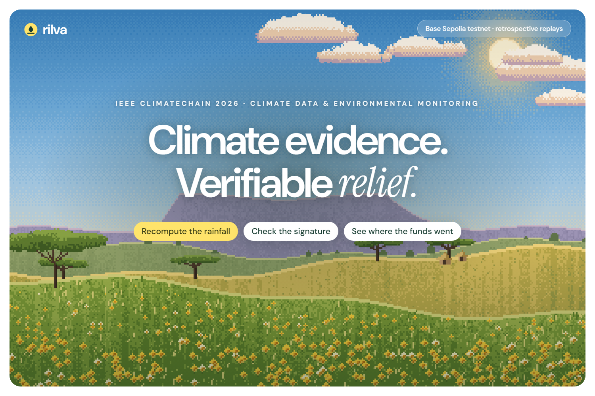
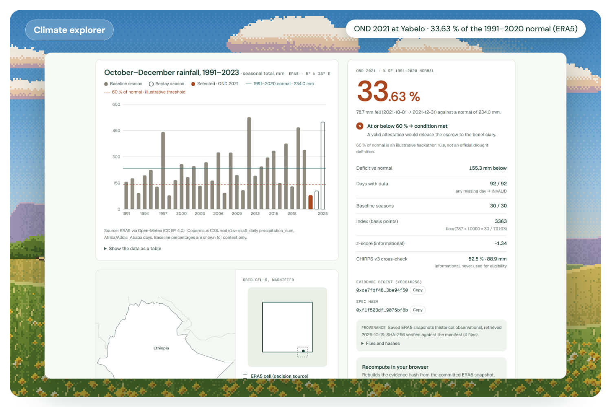
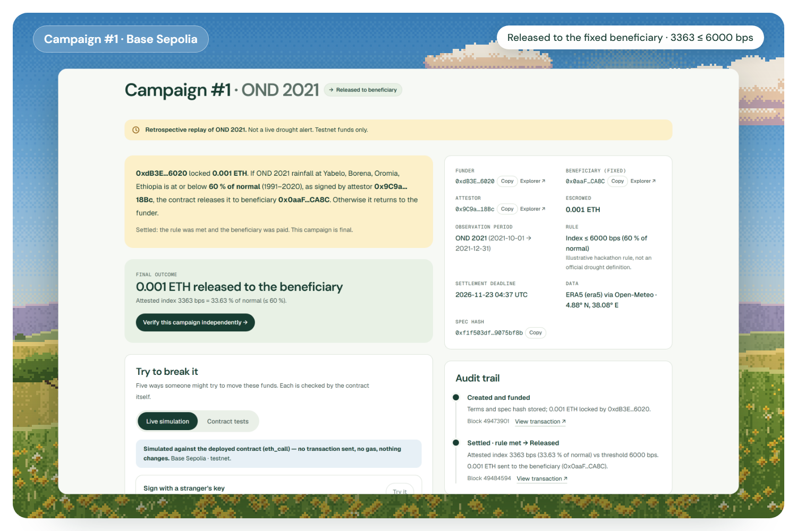
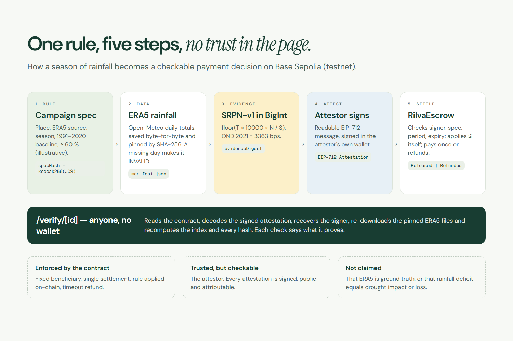
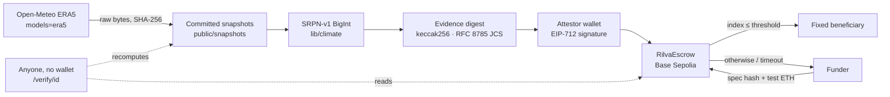

# Rilva

**Climate evidence. Verifiable relief.** Rilva turns a rainfall-based funding rule into evidence anyone can recompute, an attestation anyone can check, and a payment only that rule can trigger.

[Live app](https://rilva.xylolabs.space) · [Verify a real campaign, no wallet](https://rilva.xylolabs.space/verify/1) · [5-minute judge guide](JUDGE_GUIDE.md) · Demo video: `[VIDEO URL — pending upload]`

Built for the **IEEE ClimateChain Global Hackathon 2026**, track **Climate Data & Environmental Monitoring**.

> **Testnet demonstration with historical data.** Base Sepolia test ETH only, no real funds, no insurance and no relief delivered. Every season is a labelled **retrospective replay**, and the 60 % threshold is **illustrative**.



## The problem

Anticipatory climate finance often pre-agrees a trigger: *if the rains fail, release the funds.* From outside, three things are hard to check:
- **which data** was used;
- **how** the number was computed;
- **who decided**, and whether the money went where it was promised.

The data sources disagree, the maths lives in spreadsheets, and the audit trail is an email.

## The solution

| Step | What happens | Who or what enforces it |
|---|---|---|
| 1. Rule | Place, data source and model, season, baseline and threshold are canonicalised and hashed on-chain with the locked funds | `RilvaEscrow` stores the `specHash` |
| 2. Evidence | SRPN-v1 rainfall index from ERA5 (Open-Meteo) in integer maths, plus a keccak256 evidence digest | Deterministic code, SHA-256-pinned inputs |
| 3. Attestation | A designated attestor reviews and signs an EIP-712 message in their own wallet | The signature recovers to the attestor |
| 4. Settlement | The contract checks signer, spec, period and expiry, applies `index ≤ threshold` itself, and pays the fixed beneficiary once or refunds | Smart contract |
| 5. Verification | `/verify/[id]` recomputes everything in a stranger's browser, with no wallet | Anyone |

| Explorer | Campaign | Verification | Refund case |
|---|---|---|---|
|  |  |  |  |

## Key capabilities
- **Climate explorer:** 33 OND seasons at Yabelo vs the 1991–2020 normal, the ERA5 vs CHIRPS disagreement shown openly, and in-browser recompute.
- **Guided campaign creation:** the rule is shown in plain words and the exact spec JSON before signing.
- **Attest and settle:** recompute → readable EIP-712 field table → wallet signature → submit. Timeout refund after the deadline.
- **Public verification:** seven labelled checks (authentic, reproducible, attested, contract), a shareable report and JSON download, and an explicit "not checked, not claimed" list.
- **Try to break it:** a forged signature, settling twice and an early refund, simulated against the deployed contract with `eth_call`.

## Case study: Yabelo, Borena Zone, Ethiopia

ERA5 grid cell 5.0° N, 38.0° E (requested 4.88° N, 38.08° E). October–December rainfall against the 1991–2020 normal of 234.0 mm (S = 70193 dmm, N = 30). Computed offline from the committed snapshots:

| Season | Rainfall | % of normal | indexBps | Rule ≤ 6000 | evidenceDigest | On Base Sepolia |
|---|---|---|---|---|---|---|
| OND 2021 | 78.7 mm | 33.63 % | 3363 | Trigger | `0xde7fdf48…3be94f50` | [#1 Released](https://rilva.xylolabs.space/verify/1) |
| OND 2022 | 104.4 mm | 44.61 % | 4461 | Trigger | `0x8f4751b9…1599d19a` | [#3 Active](https://rilva.xylolabs.space/campaigns/3) |
| OND 2023 | 498.9 mm | 213.22 % | 21322 | No trigger | `0x5c28852c…6b253e` | [#2 Refunded](https://rilva.xylolabs.space/verify/2) |

Context, not computed by Rilva: FEWS NET reported OND 2021 deyr/hagaya rainfall at 45–75 % of average in southern pastoral areas, including Borena ([Dec 2021](https://fews.net/east-africa/seasonal-monitor/december-2021), accessed 2026-10-19). ERA5 (33.6 %) is drier than that range, and CHIRPS v3 gives 52.5 %. See [CLIMATE_DATA.md](CLIMATE_DATA.md) §3.

## Architecture





There is no backend database: the app reads campaign history from the contract (binary search over state, because the public RPC caps log ranges at 200 blocks). Details are in [ARCHITECTURE.md](ARCHITECTURE.md).

## Tech stack (exact pinned versions in `package.json`)
Next.js 16 · React 19 · TypeScript 5.9 · Tailwind CSS 4 · viem 2 · wagmi 3 · TanStack Query · Recharts · Solidity 0.8.37 · Hardhat 3 · OpenZeppelin Contracts 5.6 (EIP712, ECDSA, ReentrancyGuard) · Vitest · Playwright · Vercel · Base Sepolia · Open-Meteo (ERA5).

## How the rainfall evidence is computed
- **Request:** `latitude=4.88&longitude=38.08&daily=precipitation_sum&timezone=Africa/Addis_Ababa&models=era5`. The `best_match` model is never used: it switches models in 2017 (CLIMATE_DATA.md §2.1).
- **Validate:** every expected day must be present exactly once, with no null and no negative values, all in the same grid cell. Anything else makes the result `INVALID`, and nothing is gap-filled.
- **Normalise:** `dmm = round(mm × 10)`. Precision finer than 0.1 mm is rejected.
- **Index:** `indexBps = floor(T × 10000 × N / S)`, with T the observed season total and S the sum of the 30 baseline season totals. The decision is `indexBps ≤ thresholdBps`, the same `≤` as the contract.
- **Hashes:**
  - `specHash = keccak256(JCS(spec))`.
  - `evidenceDigest = keccak256(JCS(core))`, where the core holds the source, location, periods, series digest, daily values, baseline totals and result.
  - The raw-response SHA-256 values in `manifest.json` pin the inputs.
- **Pinned to snapshots:** on 2026-10-24 Open-Meteo returned revised ERA5 values for the same URLs: OND 2021 is now 3362 bps live, and every decision is unchanged. Attestations and `/verify` use the SHA-256-pinned snapshot, and the live value is shown next to it as "Upstream revised" (CLIMATE_DATA.md §2.4).

A matching digest proves **integrity and reproducibility**. It does not prove that ERA5 is ground truth, that drought impact occurred, or that anyone suffered loss.

## Smart contract security model
`RilvaEscrow` ([CONTRACTS.md](CONTRACTS.md)):
- Ownerless and non-upgradeable, with no arbitrary calls or admin keys.
- Funds can only go to the beneficiary fixed at creation, **once**, and only with the designated attestor's EIP-712 signature over the exact campaign, spec, evidence, index, period and expiry.
- The contract applies the threshold itself. If the rule is not met, the funder is refunded in the same transaction. After the deadline, anyone can trigger a timeout refund to the funder.
- Checks-effects-interactions plus `nonReentrant` on every function that moves value. Custom errors for every revert path.
- **Trust assumption:** the attestor is trusted to sign honestly. Rilva makes every attestation public, attributable and recomputable, not automatically true. Not professionally audited.

## Run it locally
Requirements: Node ≥ 24 and pnpm 11.13.1.
```bash
pnpm install
pnpm dev                       # http://localhost:3000, reads Base Sepolia (see .env.example)
pnpm climate:verify all        # offline: snapshots, SRPN-v1, digests → ALL CHECKS PASSED
```
`.env.example` lists the public variables: `NEXT_PUBLIC_RILVA_CHAIN`, `NEXT_PUBLIC_RILVA_ESCROW_ADDRESS` and `NEXT_PUBLIC_RILVA_DEPLOY_BLOCK`. No secrets are needed to run the app.

Local chain, no credentials: `pnpm chain:node`, then `pnpm chain:deploy:local` and `pnpm chain:seed:local` (DEPLOYMENT.md).

## Tests and results (run 2026-10-24)
```bash
pnpm lint && pnpm typecheck && pnpm test && pnpm climate:verify all && pnpm build
pnpm contracts:compile && pnpm contracts:test && pnpm contracts:coverage
pnpm test:e2e
```
| Suite | Result |
|---|---|
| ESLint, `tsc --noEmit` | pass |
| Vitest (climate engine, golden values, evidence, chain history, verification, copy audit) | **242 / 242 passed** (27 files) |
| `climate:verify all` (offline) | **ALL CHECKS PASSED** (3363 / 4461 / 21322 bps; committed evidence matches) |
| `climate:verify all --live` | Fails by design: live digests differ since the upstream ERA5 revision (CLIMATE_DATA.md §2.4) |
| Hardhat (`node:test`): every revert path, attacks, invariant, EIP-712 parity, real-evidence journeys | **79 passing** |
| Coverage, `RilvaEscrow.sol` | **100 % lines, 100 % statements** |
| `next build` | compiled successfully |
| Production: 1440 / 390 / 360 px, light + dark, 7 routes | no horizontal overflow, no page errors |

## Deployment
| | |
|---|---|
| Network | Base Sepolia (chain 84532), **testnet only** |
| `RilvaEscrow` | [`0x8c277493004aC7Ef14d75bd0dD31ec4dbCd0DB0E`](https://sepolia.basescan.org/address/0x8c277493004aC7Ef14d75bd0dD31ec4dbCd0DB0E) |
| Released (#1, OND 2021) | [`0xd5e77248…d95c`](https://sepolia.basescan.org/tx/0xd5e77248c989878540c6c082b2b6c877c4aa5fb3c38eba3bc6c8f5d0e807d95c) |
| Refunded, rule not met (#2, OND 2023) | [`0xb5d6d551…b019`](https://sepolia.basescan.org/tx/0xb5d6d551bfc49b13a211fe5bdad028a153c75f916ccc47e50e1c4f0f62bab019) |
| App | https://rilva.xylolabs.space (Vercel, production build of `main`) |

The full record, including creation transactions and the source-verification status, is in [DEPLOYMENT.md](DEPLOYMENT.md).

## Limitations
- ERA5 is a reanalysis model estimate for a ~28 km cell: not a rain gauge, and not regional.
- ERA5 and CHIRPS v3 disagree materially in some seasons, and providers revise archives (CLIMATE_DATA.md §2.4, §3).
- SRPN-v1 measures meteorological rainfall only. It does not measure drought impact, crop loss or financial loss.
- The 60 % threshold is illustrative and not calibrated with any programme.
- A single trusted attestor; no multi-attestor or dispute process yet.
- One location and one method. Seasons must lie within one calendar year and must not contain 29 February.
- Testnet only and not audited. No partnerships or pilots exist.

## Project documents
[PRODUCT.md](PRODUCT.md) · [CLIMATE_DATA.md](CLIMATE_DATA.md) · [ARCHITECTURE.md](ARCHITECTURE.md) · [CONTRACTS.md](CONTRACTS.md) · [DEPLOYMENT.md](DEPLOYMENT.md) · [JUDGE_GUIDE.md](JUDGE_GUIDE.md)

## Credits and data attribution
- Weather data by [Open-Meteo.com](https://open-meteo.com/) ([CC BY 4.0](https://creativecommons.org/licenses/by/4.0/)), based on ERA5: Copernicus Climate Change Service information. The app footer carries the same credit.
- CHIRPS v3.0 values are cited from Funk et al., Climate Hazards Center, UCSB, and shown for comparison only. CHIRPS data is not redistributed.
- Ethiopia outline: Natural Earth (public domain).
- Pixel-art scenes are generated procedurally in the browser.

Code: [MIT](LICENSE).
